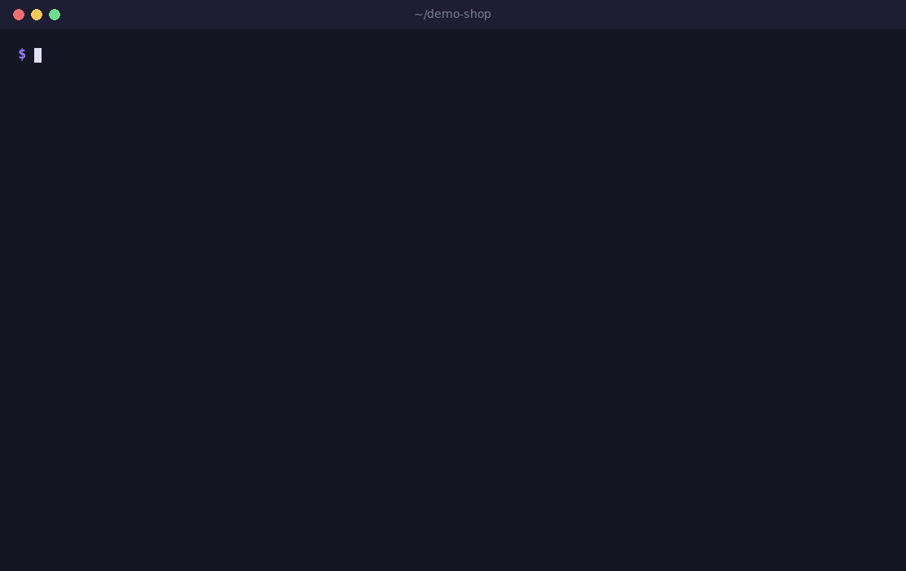
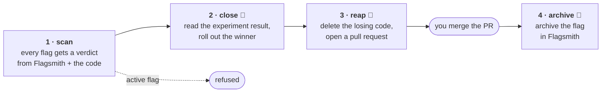
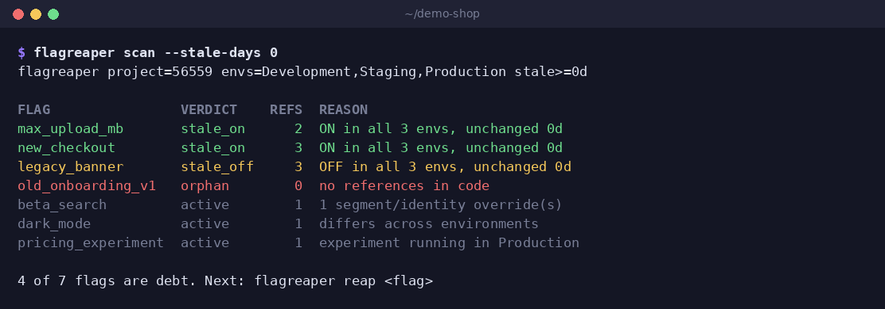
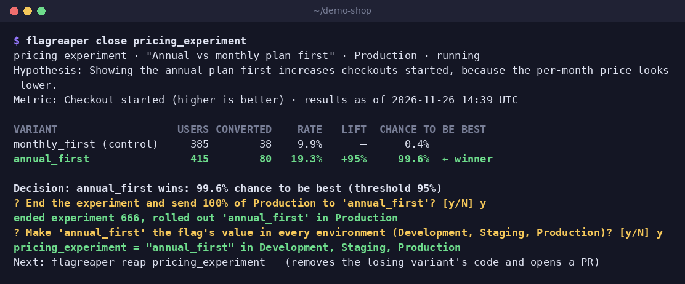
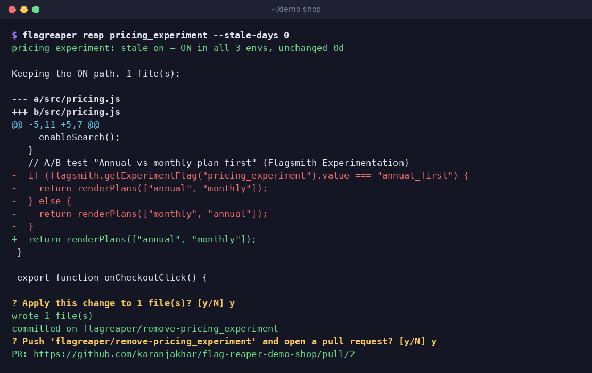
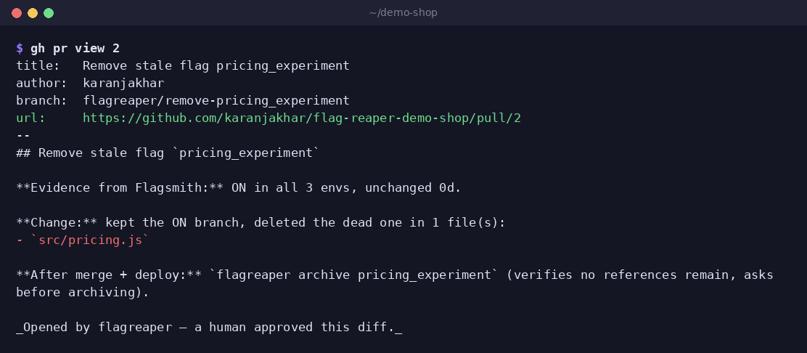
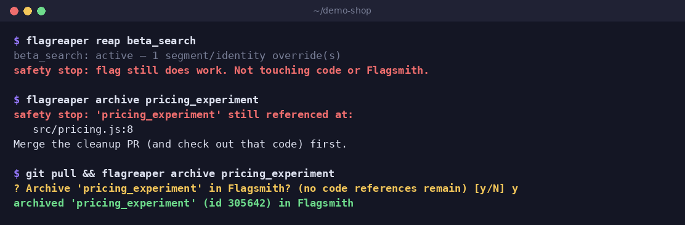
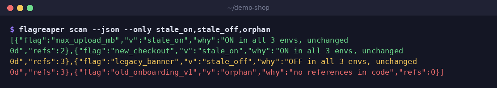

# Flag Reaper

**Finish what your A/B test started.**

Flag Reaper reads your Flagsmith Experimentation result, rolls out the winner, deletes the losing variant's code in a pull request, and archives the flag. It also finds every other flag that has stopped doing work. A person approves every change.

<p align="center">
  
</p>

<p align="center">
  <a href="demo/flag-reaper-demo.mp4"><b>▶ Demo video</b></a> (2½ min, narrated, CLI + coding agent, everything live) ·
  <a href="https://github.com/karanjakhar/flag-reaper-demo-shop/pull/2"><b>The PR it opened</b></a> ·
  <a href="skills/flagsmith-flag-reaper/SKILL.md"><b>Agent Skill</b></a> ·
  <a href="#try-it-in-30-seconds">Try it in 30 seconds</a>
</p>

Built for **Toggle Wars, the Flagsmith Experimentation Hackathon**: Track 01 (Test Something Real), Track 02 (AI Agents and Feature Flags) and Track 04 (Agent Skills).

---

## The problem

An A/B test ends and someone ships the winner to 100%. Then everyone moves on.

The flag check stays in the code, and so does the losing variant. Repeat that for every experiment and every rollout, and after a year nobody knows which flags are safe to delete. So nobody deletes them. You end up with dead code, more paths to test, and a flag dashboard nobody trusts.

The hard part isn't deleting code. It's knowing, with evidence, that a flag is finished, then doing the four chores in the right order without breaking anything.

## How it works



🙋 = stops and asks before every change. `scan` only reads. Flags that are still doing work are refused.

### 1 · scan: which flags are finished?



Flag Reaper reads every flag from Flagsmith (state in each environment, segment and identity overrides, change history) and finds where your code uses it.

| Verdict | Means | What Flag Reaper offers |
|---|---|---|
| 🟢 `stale_on` | on in every environment, same value, no overrides, unchanged for 30+ days | keep the ON code, delete the check |
| 🟡 `stale_off` | off everywhere, same conditions | delete the ON code |
| 🔴 `orphan` | exists in Flagsmith, never used in code | archive only |
| ⚪ `active` | anything else: an experiment is running, variants split traffic, segment or identity overrides, environments differ, or a recent change | **nothing. Refused.** |

The demo runs with `--stale-days 0` so freshly seeded flags qualify. The default is 30 days.

### 2 · close: read the A/B result and roll out the winner



The numbers come from Flagsmith's own Bayesian engine. Flag Reaper only applies your rule: a variant must reach **95% chance to be best** with **at least 50 users per variant** (change them with `--threshold` and `--min-users`). If there's no clear winner, it says so and changes nothing.

### 3 · reap: delete the losing code, open a PR



It shows the diff, asks, commits on a new branch, asks again, then pushes and opens a PR. The PR description carries the evidence from Flagsmith:



### 4 · archive: only once no code uses the flag



`archive` refuses while any code still references the flag, so a flag is never archived while it's still being evaluated. Once the PR is merged, it asks and then archives. Archiving can be undone in Flagsmith; nothing is deleted.

## Where it stops for a person

| Step | Automatic | Asks first |
|---|:---:|:---:|
| Read Flagsmith, read results, scan code, show the diff | ✅ | |
| End the experiment and roll out the winner | | ✅ |
| Set the winning value in every environment | | ✅ |
| Write code changes | | ✅ |
| Push and open the PR | | ✅ |
| Archive the flag | | ✅ refused while code still uses it |

Without a terminal (CI, a coding agent), every change is refused unless `--yes` is passed. The Agent Skill tells the agent to ask in chat before it ever passes `--yes`.

---

## Try it in 30 seconds

No account needed. Python 3.10+, no dependencies.

```bash
git clone https://github.com/karanjakhar/flag-reaper && cd flag-reaper
python3 -m flagreaper scan --repo examples/demo-app --demo examples/demo-flags.json
python3 -m flagreaper reap new_checkout --repo examples/demo-app --demo examples/demo-flags.json --dry-run
```

`--demo` reads an offline snapshot instead of the API. `close` needs a live project.

## Use it on your project

```bash
pip install git+https://github.com/karanjakhar/flag-reaper
```

Put these in a `.env` in your app's folder, or set them as environment variables:

```bash
FLAGSMITH_API_TOKEN=...      # Flagsmith → Account settings → API key
FLAGSMITH_PROJECT_ID=...     # the number in your project's URL
# FLAGSMITH_API_URL=https://flags.example.com/api/v1   # self-hosted only
```

Then, from your app's folder:

```bash
flagreaper scan                          # what's finished?
flagreaper close pricing_experiment      # read the result, roll out the winner
flagreaper reap pricing_experiment       # delete the losing code, open a PR
flagreaper archive pricing_experiment    # after the PR is merged
```

Works with Flagsmith Cloud and self-hosted, and with v1 and v2 feature versioning.

## Use it from a coding agent

Copy [`skills/flagsmith-flag-reaper/SKILL.md`](skills/flagsmith-flag-reaper/SKILL.md) to your agent's skills folder (for Claude Code: `.claude/skills/flagsmith-flag-reaper/SKILL.md`), then ask:

> *"Close the pricing experiment and clean up the flag."*
> *"Clean up our stale flags."*

The agent runs `flagreaper scan --json`, which returns one short line per flag, so it costs few tokens:



It shows you each result and diff, and passes `--yes` for a step only after you approve it in chat.

**A recorded run:** the last part of the [demo video](demo/flag-reaper-demo.mp4) shows Claude Code (Claude Sonnet 5.5) using the skill on the live demo project in three chat turns, ending in [PR #3](https://github.com/karanjakhar/flag-reaper-demo-shop/pull/3). The full transcript, with the token usage for each turn, is in [`demo/agent-run.json`](demo/agent-run.json). Total: 358,869 tokens, of which 343,789 are cache reads of Claude Code's own prompt and 2,149 are output.

For CI there's a weekly flag-debt report: [`examples/flag-debt-report.yml`](examples/flag-debt-report.yml).

## How Flagsmith is used

| Flagsmith feature | What Flag Reaper does with it |
|---|---|
| **Admin API** | reads flags, environment states, segment and identity overrides and change history; sets values in every environment; archives flags |
| **Experimentation** | reads per-variant results and chance-to-be-best, ends the experiment, sends 100% of traffic to the winner |
| **Python SDK** (6.3+) | the demo's traffic simulation: `get_experiment_flag()` records exposures, `track_event()` records conversions |
| **Segments** | a segment override marks a flag as `active`, so it is never touched |
| **Remote config** | value flags (`getValue("k")`) are replaced by their final value |

### The demo experiment

| | |
|---|---|
| **Hypothesis** | showing the annual plan first increases checkouts started, because the per-month price looks lower |
| **Flag** | `pricing_experiment` (multivariate): `monthly_first` (control) and `annual_first`, split 50/50 |
| **Metric** | "Checkout started", from `checkout_started` events |
| **Traffic** | 800 simulated users through the official Python SDK |
| **Result** | `annual_first` 19.3% vs 9.9%, +95% lift, **99.6% chance to be best** |

---

<details>
<summary><b>What the code rewriter understands</b></summary>

| Pattern | Languages |
|---|---|
| `if [not] flags.is_feature_enabled("k"):` … `elif` … `else:` | Python |
| `if ([!]flagsmith.hasFeature("k")) {…} else if (…) {…} else {…}` | JS/TS, Java, Kotlin, Go, Dart |
| `getExperimentFlag("k").value === "annual_first"` and `get_experiment_flag("k", identifier=…).value == …` | experiment flags |
| `getValue("k")`, `get_feature_value("k")` | replaced by the final value, comparisons folded |
| `cond ? a : b`, `a if cond else b` | JS/TS, Python |

Only expressions that come from the flag being removed are ever folded. An unrelated `if (true)` elsewhere is left alone. When a flag is used in a way the rewriter doesn't recognise (for example stored in a constant), `reap` lists the places and stops so you can edit them by hand.

</details>

<details>
<summary><b>Honest notes</b></summary>

- Verdicts are cautious on purpose. If an override count can't be read, the flag counts as `active`.
- Code changes ship first and the flag is archived last. Archiving a flag that's still evaluated would flip users to the default.
- Edge identity overrides aren't visible through the endpoints used. Check those flags yourself if you target individual users.
- Ending an experiment and setting its result use endpoints from Flagsmith's coding-agent guide, plus `experiments/<id>/complete/` (found by testing on throwaway flags, not yet in the public docs).
- The demo experiment uses simulated traffic (800 users through the official Python SDK), which the hackathon allows. Each simulated user converts with a set probability: 10% for `monthly_first`, 16% for `annual_first`. The observed rates (9.9% and 19.3%) differ from those because it's a random sample of a few hundred users per variant. The random seed is fixed (`--seed 7`), so the same command produces the same rolls.

</details>

<details>
<summary><b>Reproduce the demo</b></summary>

```bash
python3 demo/seed_flagsmith.py                 # 3 environments, 7 flags, a segment override, an A/B flag
.venv/bin/python demo/simulate_traffic.py --flag pricing_experiment --event checkout_started \
    --users 800 --rate monthly_first=0.10 --rate annual_first=0.16
python3 demo/record.py ../flag-reaper-demo-shop   # runs the real commands, answers the prompts
python3 demo/render.py                          # transcript + narration -> demo/flag-reaper-demo.mp4
python3 demo/stills.py                          # transcript -> the README images in docs/img/
```

The voiceover is generated offline with [Piper](https://github.com/OHF-Voice/piper1-gpl) (voice `en_US-ryan-high`) from [`demo/narration.json`](demo/narration.json). Each scene stretches to fit its line. Setup: `.venv/bin/pip install piper-tts` and `.venv/bin/python -m piper.download_voices en_US-ryan-high` in `~/.cache/piper-voices`. Set `NO_VOICE=1` for a silent render.

Every image in this README is rendered from [`demo/transcript.json`](demo/transcript.json), the output of the recorded live session, not mocked up.

</details>

## Development

```bash
python3 -m unittest discover -s tests -v   # 37 tests, including end-to-end runs on the demo app
```

| File | Job |
|---|---|
| [`flagreaper/api.py`](flagreaper/api.py) | talks to Flagsmith |
| [`flagreaper/analyze.py`](flagreaper/analyze.py) | decides verdicts |
| [`flagreaper/rewrite.py`](flagreaper/rewrite.py) | edits code |
| [`flagreaper/cli.py`](flagreaper/cli.py) | commands and approval prompts |

MIT licensed.
